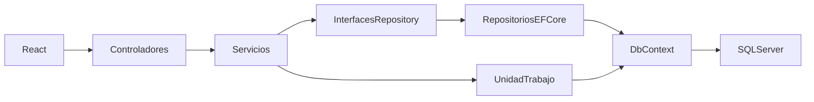

# Patrón Repository

## Objetivo y recorrido

El acceso a las entidades académicas se concentra en repositorios. Los servicios conservan las reglas de negocio y los controladores gestionan HTTP y permisos. Los repositorios no exponen `IQueryable` ni `DbSet` a las capas superiores.



## Componentes

| Interfaz | Implementación | Responsabilidad |
|---|---|---|
| `IEstudianteRepository` | `EstudianteRepository` | Alta, consulta de estudiantes activos, perfil y registros paginados de otros estudiantes |
| `IMateriaRepository` | `MateriaRepository` | Materias disponibles y consulta de una materia con su profesor |
| `IInscripcionRepository` | `InscripcionRepository` | Consultas de inscripciones activas, duplicados, profesores, compañeros y alta de inscripciones |
| `IUnidadTrabajo` | `UnidadTrabajo` | Guardar cambios e iniciar una transacción compartida |
| `ITransaccionDatos` | Implementación interna de la unidad de trabajo | Confirmar y desechar una transacción sin exponer tipos de EF Core al servicio |

Las interfaces y clases están en `SistemaInscripcionesAcademicas.Api/Repositories`. `AddPersistenciaAcademica`, en `Extensions`, registra los tres repositorios y la unidad de trabajo como scoped. Todos reciben la misma instancia scoped de `ApplicationDbContext` que utiliza Identity.

## Reglas y persistencia

- `InscripcionService` decide si la inscripción cumple las reglas de estudiante activo, materia disponible, máximo de tres, ausencia de duplicados y profesor no repetido. Los repositorios ejecutan las consultas necesarias.
- Los métodos `Agregar` preparan entidades; no guardan por su cuenta. Los servicios llaman a `IUnidadTrabajo.GuardarCambiosAsync` cuando corresponde.
- En el registro, `EstudianteService` abre una transacción, crea el usuario y asigna el rol con Identity, agrega el estudiante mediante el repositorio, guarda y confirma. Si cualquier paso falla, desechar la transacción revierte los cambios.
- La actualización del usuario conserva `UserManager.UpdateAsync`, sus validadores y la normalización del correo. No se implementa un repositorio alternativo de contraseñas o roles.
- Las consultas de listas proyectan únicamente los DTO necesarios y usan `AsNoTracking`. Las entidades que se modifican se recuperan con seguimiento.
- La paginación, los filtros de actividad, el orden estable y los filtros de privacidad se ejecutan dentro de los repositorios.

## Compatibilidad

Se conservan rutas, contratos JSON, autenticación, Swagger, reglas de inscripción y bajas lógicas. No se requieren migraciones ni cambios en el frontend.

La unidad de trabajo conserva la transacción del registro y añade una transacción con bloqueo SQL Server por estudiante para inscribir y cancelar. Consulta [la protección de concurrencia](concurrencia.md).

## Verificación

Se adaptó la composición de dependencias de las pruebas existentes y se añadió una prueba HTTP que verifica el catálogo disponible, la inscripción de dos estudiantes, el rechazo de duplicados y profesor repetido, la exposición exclusiva de nombres de compañeros, el rechazo de cancelar una inscripción ajena, la cancelación propia y la reinscripción conservando el historial.

Resultado actualizado: **74 casos aprobados**, incluidas pruebas HTTP con SQLite y seis pruebas de concurrencia contra SQL Server real en bases temporales. También se verificó que no existan referencias a `ApplicationDbContext` o EF Core en servicios y controladores.

La comprobación se ejecutó en una copia del código actualizado porque la API abierta bloqueaba su ejecutable. Para utilizar los cambios en la sesión local, reinicia la API y vuelve a ejecutar:

```powershell
dotnet test SistemaInscripcionesAcademicas.slnx
```
